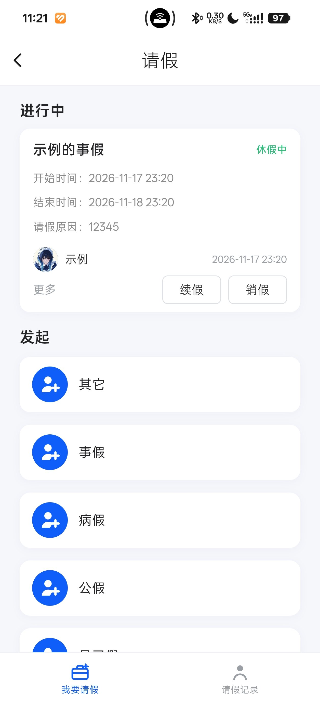
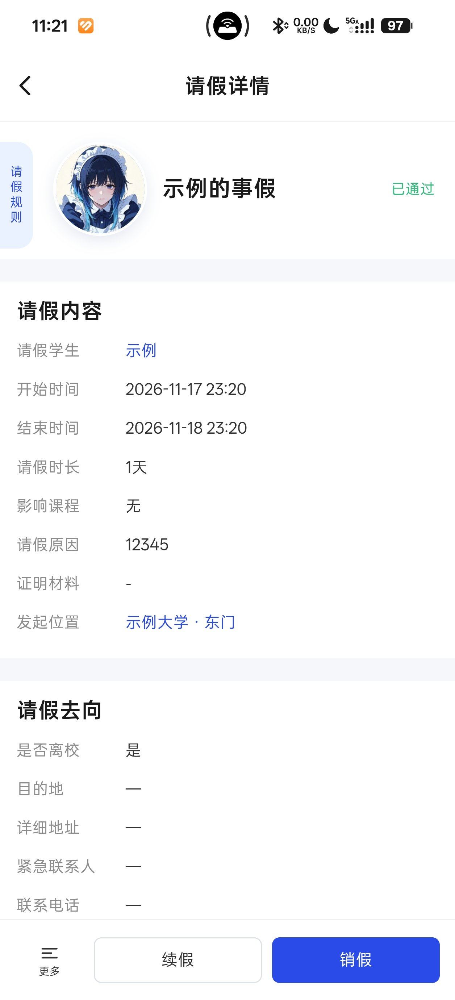
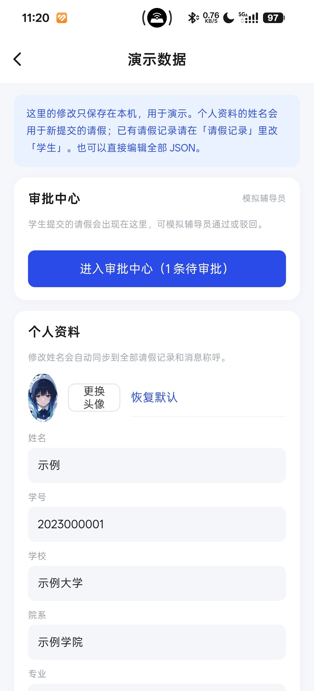

<h1 align="center">📱 今日校园 · 请销假仿真界面</h1>

<h3 align="center">申请 → 审批 → 销假 → 续假　全流程点得动、批得下来</h3>

<p align="center"><strong>自己请假，自己当辅导员 · 全部数据可改 · 纯前端零联网</strong></p>

<p align="center">
  
  
  
  
  
  
  
  
</p>

<p align="center">
  <a href="../../releases/latest"><strong>⬇️ 立即下载 v2.1.33（86 KB）</strong></a>
</p>

> **装完就能玩：** 打开是「示例大学」首页 → 点「请销假」→ 自己提交一条事假 → 去「演示数据」里的审批中心自己批 → 回来销假、续假，整个闭环两分钟走完。
>
> **这是「今日校园」的仿真界面，不是官方 App。** WebView 壳 + 本地前端，按官方信息架构复刻请销假流程，另附课表、工资、综合测评、讯息等页面。**没有联网、没有后端、不连接任何学校系统。**
>
> ⚠️ **「今日校园」是官方名称与商标**，本项目与之无关、未获授权。**禁止**冒充官方应用、伪造审批结果或欺骗学校；权利人要求即下架。

---

## 界面一览

| 今日首页 | 请销假 | 请假详情 | 演示数据 / 审批中心 |
| --- | --- | --- | --- |
|  |  |  |  |

## 一分钟看懂

| 你可能想知道的 | 答案 |
| --- | --- |
| 这是官方「今日校园」吗 | **不是**，是界面复刻的演示版 |
| 能真的请假吗 | 不能，数据只写在本机 `localStorage`，不发给任何人 |
| 要联网吗 | **不需要**，整个 App 零网络请求 |
| 有后端吗 | 没有，`classes.dex` 只有 9.7 KB，就是个 WebView 桥 |
| 数据会丢吗 | 清数据/重装就没了，内置「重置数据」按钮 |
| 数据能改吗 | **全部可改**：自己请假、自己审批、自己销假续假、增删记录、导入 JSON、重置 |
| 能自己审批吗 | 能，演示数据里有「审批中心（模拟辅导员）」，自己点通过或驳回 |
| 有什么用 | 学前端、临摹 UI、产品演示、把请销假流程当沙盘随便演练 |

## 仿真请销假（核心）

本项目的重点不是"摆几个页面"，而是把「今日校园」的**请销假闭环**按真实操作顺序仿真出来——每一步都能点、状态会流转、时长会算、审批会留痕（仅本机）。

### 仿真了什么

| 环节 | 仿真程度 |
| --- | --- |
| 请假申请 | 事假 / 病假两类；开始、结束时间可选；**时长自动计算**（跨天、半天都算对） |
| 请假原因 | 多行输入，提交前校验必填 |
| 状态流转 | 待审批 → 已通过 / 已驳回，状态色与文案与实体界面一致 |
| 审批演示 | 审批人（辅导员 / 李老师）可见，同意可附意见，驳回需填理由 |
| 销假 | 已通过记录可销假，销假后状态与列表同步更新 |
| 续假 | 可对已通过记录发起续假，时长与记录链一并更新 |
| 请假记录 | 列表按状态筛选、进入详情、删除单条记录 |
| 记录留痕 | 申请人、审批人、时间、时长、意见，全在本地快照里 |

### 和真实的差别

| 项 | 官方 App | 本仿真 |
| --- | --- | --- |
| 数据去哪 | 学校服务器，辅导员真的会看到 | **只写本机 localStorage**，谁都收不到 |
| 审批 | 真人审批，有真实效力 | 本地按钮，点一下就是"通过" |
| 联网 | 必须登录校园账号 | **零请求**，断网可用 |
| 效力 | 是正式请假凭证 | **没有任何效力**，不能当请假依据 |

## 全部数据可编辑：自己请假、自己审批

仿真界面里没有"只读"这回事——**所有数据都在你手上，你既是申请人，也是审批人**。

| 你能做什么 | 具体怎么操作 |
| --- | --- |
| 改自己的身份 | 姓名、学工号、学院、班级随便填；头像可本地选图、拖动缩放裁剪后保存 |
| 自己发起请假 | 选事假/病假，定起止时间，写原因，提交 → 立刻出现在「请假记录」里，状态待审批 |
| 自己当审批人 | 打开待审批记录，点「同意」可附审批意见，点「驳回」需填理由，状态实时变成已通过/已驳回 |
| 自己销假 | 已通过的记录点「销假」，状态与列表同步刷新 |
| 自己续假 | 对已通过的记录发起续假，时长与记录链重新计算 |
| 自己改/删记录 | 进入详情修改内容，或直接删除单条记录 |
| 改其他模块数据 | 课表、工资条目、综合测评分数、消息列表都可以自己增删改 |
| 导入自己的数据 | 支持载入 JSON 数据快照，一次替换整套演示数据 |
| 一键恢复出厂 | 设置里「重置数据」，回到内置的示例大学/示例学院/李老师/示例同学那套初始状态 |

数据全部写在本机 `localStorage`（键名以 `todaycampus_demo` 开头），改完即时保存，关掉 App 再开还在；清数据或重装就回到初始。

**换句话说：这是一个可以随便折腾的校务系统沙盘**——想把请假记录堆到三十条、想演一遍"被驳回再续假"、想看看审批通过后列表长什么样，都由你决定。它只是不连接任何真实系统。

## 功能

### 今日首页

- 顶部学校名（默认「示例大学」）
- 搜索框：按**应用名称 / 学工号 / 姓名**搜
- 五个快捷入口：**请销假、综合测评、我的课表、工资查询、更多**
- 「推荐内容」校园资讯卡片：标题、插图、来源、浏览量、日期
- 底部五个 tab：今日 / 讯息 / 服务 / 校园 / 我的

### 请销假

| 区块 | 内容 |
| --- | --- |
| 进行中 | 状态标签（如「休假中」）、开始与结束时间、请假原因、申请人头像与时间，右侧「续假」「销假」 |
| 发起 | 按类型发起：其它 / 事假 / 病假 / 公假 …（点哪个进哪个的表单） |
| 底部栏 | 我要请假 / 请假记录 两个 tab |

### 请假详情

| 区块 | 字段 |
| --- | --- |
| 请假内容 | 请假学生、开始时间、结束时间、**请假时长（自动算，例：1 天）**、影响课程、请假原因、证明材料、发起位置（如「示例大学 · 东门」） |
| 请假去向 | 是否离校、目的地、详细地址、紧急联系人、联系电话 |
| 其他 | 右上「请假规则」、底部「更多 / 续假 / 销假」 |

### 演示数据（可自己当辅导员）

| 模块 | 内容 |
| --- | --- |
| 审批中心 | 标注「模拟辅导员」，按钮显示「进入审批中心（N 条待审批）」；学生提交的请假在这里出现，可**通过或驳回** |
| 个人资料 | 更换头像 / 恢复默认；姓名、学号、学校、院系、专业可改；**改姓名会自动同步到全部请假记录与消息称呼** |
| 全量编辑 | 页面明示「也可以直接编辑全部 JSON」，整套演示数据随你替换 |

### 其他模块

我的课表（周课表）、工资查询（条目明细）、综合测评（分项评分）、讯息 / 头条（校园资讯列表）。

## 包信息

| 项 | 值 |
| --- | --- |
| 包名 | `com.dsh.todaycampus` |
| 版本 | versionName 2.1.33 |
| 签名 | `CN=TODAYCAM`（v1，自签） |
| 体积 | 87,913 字节（86 KB），26 个文件 |
| 结构 | `MainActivity`（WebView + JS Bridge）+ `assets/www`（HTML/CSS/JS，214 KB） |
| 网络 | **无**：全包只有 `localStorage` 读写，没有任何 `fetch`/`XHR`/WebSocket |
| 存储 | 浏览器 localStorage，键名 `todaycampus_demo*` |
| 权限 | 无敏感权限（清单里只有 WebView 基础配置） |

## 使用

1. 安装 APK（允许未知来源）。
2. 打开即进入演示首页，示例数据已内置（示例大学 / 示例学院 / 李老师 / 示例同学）。
3. 点「请假」走一遍申请 → 审批 → 销假；记录只在你这台手机上。
4. 想恢复初始状态：设置里点「重置数据」。

## 校验

```
文件：todaycampus-demo-2.1.33.apk
大小：87,913 字节
SHA-256：7c53cf44e89b8a3b9955619f778b06fc4560aad5e2580b6852af5c92b0a17d43
签名：v1（CN=TODAYCAM）
```

```bash
sha256sum todaycampus-demo-2.1.33.apk
```

## 已知问题

- 只是演示：所有「审批通过」都是本地状态，**不具备任何真实效力**。
- 数据在 localStorage，清应用数据、卸载重装即丢，没有导出功能。
- 自签证书，部分手机会提示风险；应用商店不会收录。
- 页面为固定示例数据，不能接入真实学校账号（也没有这个设计）。
- 本仓库只分发 APK，不含构建脚本与源码工程。

## 免责声明

见 [DISCLAIMER.md](DISCLAIMER.md)。要点：**与今日校园官方无关；这是请销假的仿真界面，不具备任何效力；禁止拿它去违规请假、伪造考勤或欺骗学校——由此产生的旷课、处分、学业后果全部由你自担；无网络、无数据上传；责任上限为零。**

---

**English (short)**: A UI demo of a campus app (leave request, timetable, messages) built as a WebView + local HTML/JS. Not the official app, no network, no backend. For learning and prototyping only.
